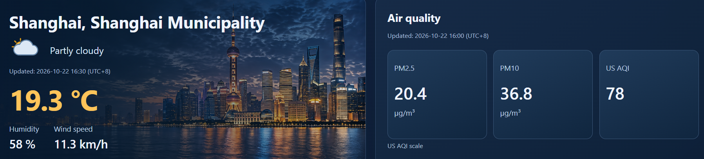
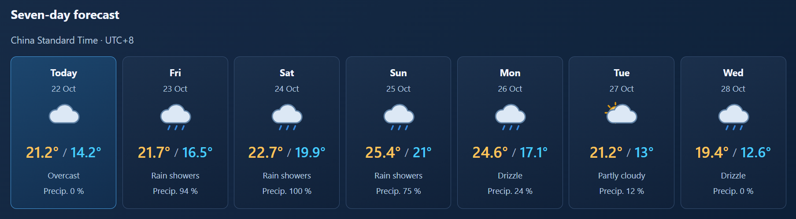
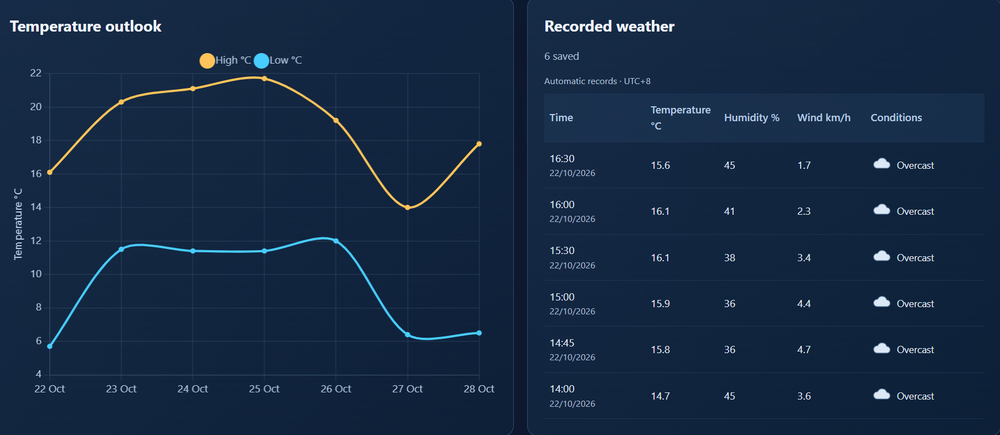

# Weather Analytics

A global weather intelligence platform combining a Python/FastAPI backend, PostgreSQL storage, and an interactive dashboard for forecasts, air quality, and recorded weather across countries and regions.

## Live Dashboard

[Open Weather Analytics](http://37.27.39.68:8001/dashboard)

Explore weather, air quality, forecasts, and recorded readings for cities worldwide.

## Features

- Search cities worldwide and filter by country and region
- View current weather and seven-day forecasts
- Monitor PM2.5, PM10, and US AQI
- Explore temperature trends with interactive charts
- Store weather readings in PostgreSQL with duplicate protection
- Automatically collect weather for tracked locations every 30 minutes using systemd
- Use a responsive web dashboard

## Dashboard Preview

### Current Weather and Air Quality

Displays temperature, humidity, wind speed, PM2.5, PM10, and US AQI for the selected location.



### Seven-Day Forecast

Shows daily weather conditions, high and low temperatures, and precipitation probabilities.



### Temperature Trends and Recorded Weather

Visualizes forecast temperatures and displays weather readings stored in PostgreSQL.



## Technologies

- **Backend:** Python, FastAPI, REST APIs, asynchronous programming
- **Databases:** PostgreSQL, SQL, SQLite
- **Frontend:** HTML, CSS, JavaScript, Chart.js
- **Deployment:** Docker, Docker Compose, Linux, systemd
- **Development:** Git, GitHub, GitHub Actions

## Local Setup

Requires Python 3.12 or newer and Docker with Docker Compose.

1. Clone the repository and open its directory.
2. Copy `.env.example` to `.env`.
3. Set a strong `POSTGRES_PASSWORD` in `.env`.
4. Prepare the location data:

   ```bash
   python3 app/data/build_locations.py
   python3 app/data/build_location_db.py
   ```

5. Build and start the application:

   ```bash
   docker compose up -d --build
   ```

6. Open `http://localhost:8001/dashboard` on the computer running the application.

To use the hosted version, follow the Live Dashboard link above.

## Automatic Data Collection

The deployment files assume the project is installed at `/opt/weather-analytics`. Adjust the service path if necessary.

Install and enable the timer:

```bash
sudo cp deploy/weather-collector.service /etc/systemd/system/
sudo cp deploy/weather-collector.timer /etc/systemd/system/
sudo systemctl daemon-reload
sudo systemctl enable --now weather-collector.timer
```

A location joins the collection list after its first successful dashboard recording. The server then collects weather at `:00` and `:30` each hour, even when the browser is closed.

Recorded timestamps represent the provider’s weather time. Collection time is stored separately. Air-quality values are displayed but are not currently stored in history.

## Continuous Integration

GitHub Actions checks Python and dashboard JavaScript syntax, validates Docker Compose configuration, and builds the application image.

## Data Sources

- **Weather and geocoding:** [Open-Meteo](https://open-meteo.com/)
- **Air quality:** [CAMS](https://atmosphere.copernicus.eu/) through Open-Meteo
- **Location data:** [GeoNames](https://www.geonames.org/) — CC BY 4.0

Data are model-based estimates. US AQI uses the United States air-quality index scale.

## Project Status

Personal software development and portfolio project.
